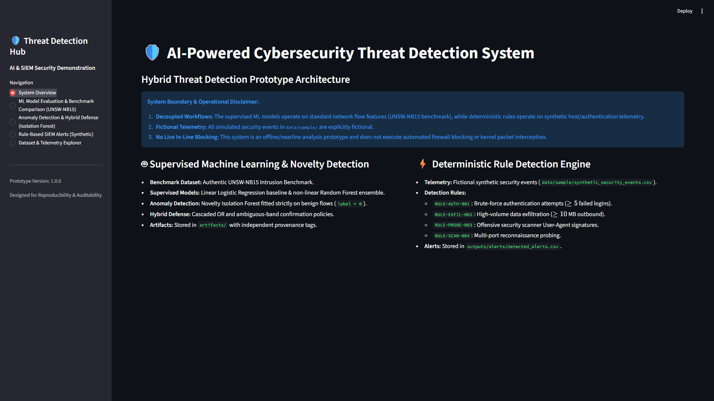
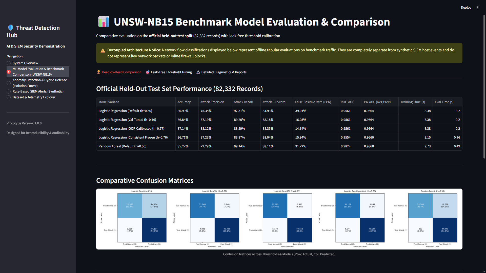
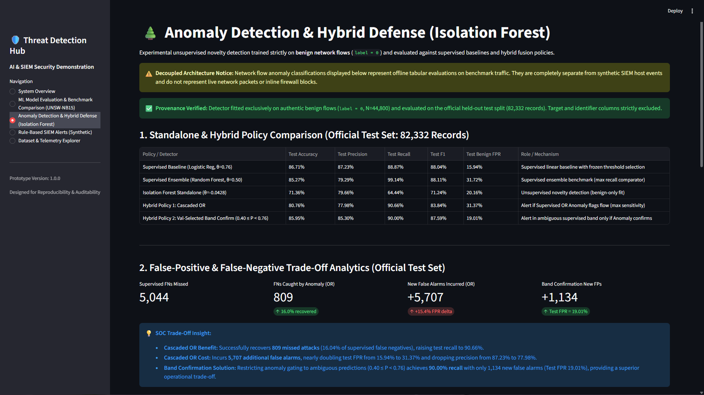
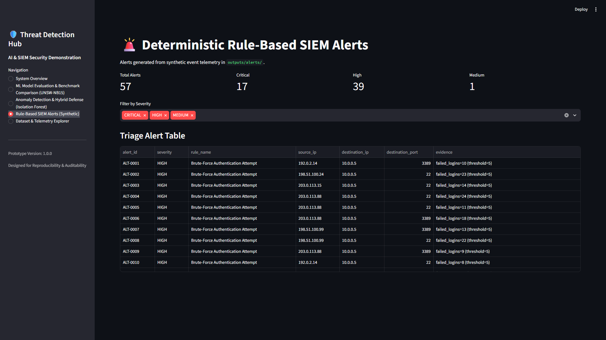
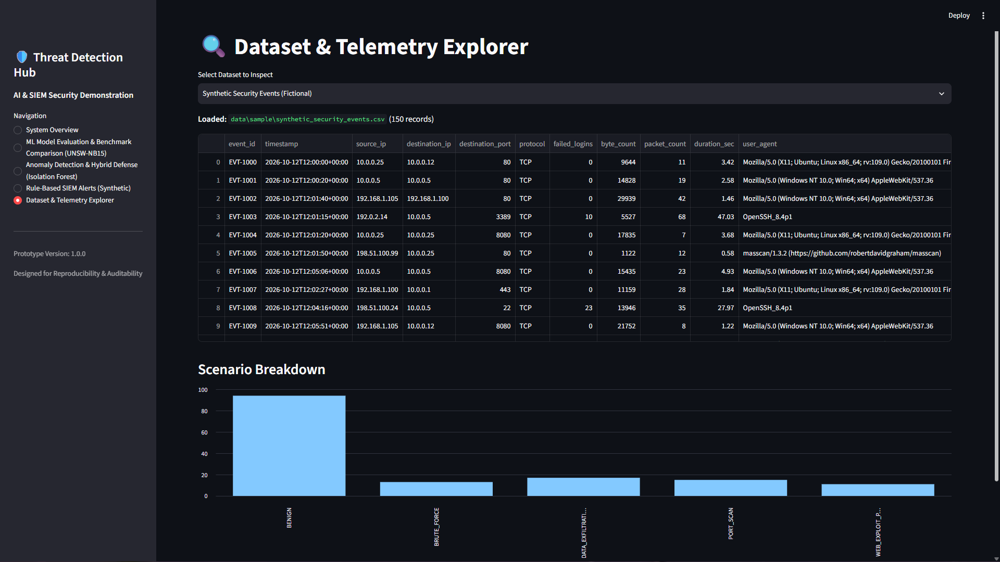

# AI-Powered Cybersecurity Threat Detection System

A modular, reproducible machine learning and security telemetry evaluation system demonstrating two decoupled workflows:
1. Supervised and Novelty Machine Learning Pipeline: Evaluates tabular network flow traffic using the authentic UNSW-NB15 benchmark, featuring leak-free threshold calibration, parameter-invariant models, and hybrid anomaly gating.
2. Deterministic Rule-Based SIEM Engine: Ingests structured host and authentication telemetry to detect brute-force attacks, data exfiltration, reconnaissance scans, and offensive tool user-agents.

---

## Executive Summary

Modern enterprise Security Operations Centers (SOC) face high alarm volumes and evolving intrusion vectors. This project implements a hybrid detection architecture that balances high recall with operational false alarm suppression.

Key capabilities include:
- Linear and Non-Linear Supervised Classification: Logistic Regression baseline and Random Forest ensemble evaluated on the authentic held-out UNSW-NB15 test split (82,332 flows).
- Methodological Rigor: Threshold selection conducted exclusively on internal training partitions with zero test set exposure. A parameter-invariant frozen model deployment eliminates calibration drift.
- Unsupervised Novelty Anomaly Detection: An Isolation Forest detector fitted exclusively on benign traffic (label = 0) to detect atypical deviations.
- Hybrid Confirmation Policy: An ambiguous-band confirmation mechanism (0.40 <= P < 0.76) that captures missed attacks while constraining false alarm inflation.
- Deterministic Rule Engine: Production-grade SIEM rules evaluating host telemetry with structured triage metadata.
- Interactive Web Dashboard: A Streamlit interface providing comparative analytics, confusion matrices, ROC/PR curves, and alert triage tables.

---

## Operational Scope and System Boundaries

Notice on prototype boundaries and production constraints:
- Decoupled Architectures: Network flow classifications on the UNSW-NB15 benchmark are separate from host-level SIEM telemetry. The schemas are distinct and evaluated independently.
- Offline and Nearline Processing: This prototype operates on tabular records and batch event logs. It does not perform live kernel-level packet capture, inline routing, or automated firewall blocking.
- Fictional Demonstration Telemetry: Simulated security event records located in `data/sample/` are fictional demonstration mocks generated for reproducible testing.
- Benchmark Generalization Caveat: Performance metrics on benchmark datasets provide a standardized baseline but do not guarantee identical detection rates against encrypted payloads, zero-day vulnerabilities, or evasive malware in live corporate networks.

---

## User Interface and Dashboard Walkthrough

The system includes a Streamlit web application for security analysts and managers. The visual walkthrough below illustrates each module. Place corresponding screenshot files in the `images/` directory to display them directly on GitHub.

### 1. System Overview Interface
Overview of decoupled pipeline architecture, security disclaimers, and module summaries.



### 2. UNSW-NB15 Benchmark Model Evaluation and Comparison
Head-to-head performance comparisons across supervised models, confusion matrices, ROC curves, Precision-Recall curves, and parameter-invariant threshold diagnostics.



### 3. Novelty Anomaly Detection and Hybrid Defense
Trade-off analytics showing false negative recovery, false positive inflation, anomaly score distributions, and candidate sweep results for the suspicious-band confirmation policy.



### 4. Deterministic SIEM Threat Alerts
Severity breakdown metrics (Critical, High, Medium, Low), multi-attribute severity filtering, and tabular alert triage evidence.



### 5. Dataset and Telemetry Explorer
Interactive data explorer displaying synthetic host logs and benchmark flow schemas.



---

## Technical Architecture

```text
+-----------------------------------------------------------------------------------+
|                                TELEMETRY INPUTS                                   |
+-------------------------------------------------+---------------------------------+
                                                  |
        [Tabular Network Flows]                   |      [Host / Authentication Logs]
        Authentic UNSW-NB15 Benchmark             |      Synthetic SIEM Telemetry
        (175,341 Train / 82,332 Test)             |      (data/sample/events.csv)
                                                  |
+-------------------------------------------------+---------------------------------+
|                         MACHINE LEARNING PIPELINE                                 |
+-----------------------------------------------------------------------------------+
|  1. Preprocessing: ColumnTransformer, Robust Imputation, One-Hot Encoding         |
|  2. Supervised Baseline: Logistic Regression (Default theta=0.50)                 |
|  3. Calibrated Supervised: Frozen 80/20 Logistic Regression (theta=0.76)         |
|  4. Supervised Ensemble: Random Forest (theta=0.50, n_estimators=100)             |
|  5. Unsupervised Novelty: Isolation Forest (Benign-only fit, N=44,800)            |
|  6. Hybrid Fusion: Suspicious-Band Confirmation Policy (0.40 <= P < 0.76)         |
+-----------------------------------------------------------------------------------+
                                                  |
+-------------------------------------------------+---------------------------------+
|                       DETERMINISTIC RULE ENGINE                                   |
+-----------------------------------------------------------------------------------+
|  - RULE-AUTH-001: Brute-Force Authentication (>= 5 failed attempts)               |
|  - RULE-EXFIL-002: Large Outbound Data Transfer (>= 10 MB payload)                |
|  - RULE-PROBE-003: Offensive Tool Signatures (Sqlmap, Nikto, Nmap User-Agents)    |
|  - RULE-SCAN-004: Port Scanning Probing (>= 10 distinct destination ports)        |
+-----------------------------------------------------------------------------------+
                                                  |
+-------------------------------------------------+---------------------------------+
|                      PRESENTATION & TRIAGE LAYER                                  |
+-----------------------------------------------------------------------------------+
|  - Streamlit Web Dashboard (System Overview, Model Compare, Hybrid, Alerts)       |
|  - Standardized JSON Performance Artifacts (artifacts/metrics*.json)              |
|  - Exportable CSV Alert Triage Reports (outputs/alerts/detected_alerts.csv)       |
+-----------------------------------------------------------------------------------+
```

---

## Machine Learning Benchmark Evaluation (UNSW-NB15)

### Dataset Overview
The UNSW-NB15 dataset is an established network intrusion benchmark created by the Australian Centre for Cyber Security (ACCS). It contains synthetic modern attack activities and normal network traffic generated via the IXIA PerfectStorm tool.
- Training Split: 175,341 records (119,341 attack flows, 56,000 normal flows).
- Official Test Split: 82,332 records (45,332 attack flows, 37,000 normal flows).
- Preprocessing: Standard scaling for numerical features and one-hot encoding for categorical protocols, services, and connection states. Target columns (`label`, `attack_cat`) and identifiers (`id`) are strictly excluded prior to feature fitting.

### Benchmark Evaluation Results (Official Test Set: 82,332 Records)

| Model Configuration | Decision Threshold | Test Accuracy | Test Precision | Test Recall | Test F1-Score | False Alarm Rate (FPR) | ROC-AUC | PR-AUC |
| :--- | :---: | :---: | :---: | :---: | :---: | :---: | :---: | :---: |
| Logistic Regression (Default Baseline) | theta = 0.50 | 80.99% | 75.35% | 97.31% | 84.93% | 39.01% | 0.9561 | 0.9664 |
| Logistic Regression (Validation Tuned) | theta = 0.76 | 86.84% | 87.19% | 89.20% | 88.18% | 16.05% | 0.9561 | 0.9664 |
| Logistic Regression (OOF Calibrated) | theta = 0.77 | 87.14% | 88.12% | 88.59% | 88.35% | 14.64% | 0.9561 | 0.9664 |
| **Logistic Regression (Consistent Frozen)** | **theta = 0.76** | **86.71%** | **87.23%** | **88.87%** | **88.04%** | **15.94%** | **0.9554** | **0.9660** |
| Random Forest Classifier | theta = 0.50 | 85.27% | 79.29% | 99.14% | 88.11% | 31.72% | 0.9822 | 0.9868 |
| Isolation Forest (Standalone Novelty) | theta = -0.0428 | 71.36% | 79.66% | 64.44% | 71.24% | 20.16% | 0.7899 | 0.8106 |
| Hybrid Policy 1: Cascaded OR | Dual Gating | 80.76% | 77.98% | 90.66% | 83.84% | 31.37% | N/A | N/A |
| **Hybrid Policy 2: Band Confirmation** | **0.40 <= P < 0.76** | **85.95%** | **85.30%** | **90.00%** | **87.59%** | **19.01%** | **N/A** | **N/A** |

### Confusion Matrix Breakdown (Official Test Split)
- Logistic Regression Baseline (theta = 0.50): TN = 22,566, FP = 14,434, FN = 1,218, TP = 44,114
- Logistic Regression Consistent (theta = 0.76): TN = 31,101, FP = 5,899, FN = 5,044, TP = 40,288
- Random Forest Classifier (theta = 0.50): TN = 25,264, FP = 11,736, FN = 392, TP = 44,940
- Isolation Forest Standalone (theta = -0.0428): TN = 29,541, FP = 7,459, FN = 16,120, TP = 29,212
- Hybrid Policy 1 (Cascaded OR): TN = 25,394, FP = 11,606, FN = 4,235, TP = 41,097
- Hybrid Policy 2 (Band Confirmation): TN = 29,967, FP = 7,033, FN = 4,531, TP = 40,801

---

## Methodological Rigor: Leak-Free Calibration

In SOC operations, the default decision threshold of 0.50 produces a 39.01% false positive rate (14,434 false alarms), which overwhelms triage capacity.

To solve this, decision thresholds were calibrated under strict leakage-prevention protocols:
1. Zero Test Set Leakage: All candidate thresholds were evaluated strictly on partitions of the official training dataset. The official test dataset (82,332 records) was unobserved during threshold exploration.
2. Formulation: Minimize False Positive Rate (FPR) subject to validation attack recall >= 90.0%.
3. Out-of-Fold (OOF) Analysis: 5-fold cross-validation across all 175,341 training records selected theta = 0.77. However, refitting the model on 100% of the training set alters sample size and coefficient scaling.
4. Parameter-Invariant Frozen Model: The training set was partitioned into 80% subtrain (N=140,272) and 20% validation (N=35,069). The model fitted on the 80% split selected theta = 0.76 on validation data and was evaluated on the test set without refitting. This guarantees zero refit drift and full parameter invariance.
5. Impact: Threshold 0.76 eliminates 8,523 false alarms (FPR drops from 39.01% to 15.94%) while maintaining 88.87% attack recall.

---

## Novelty Anomaly Detection and Hybrid Defense

An unsupervised Isolation Forest detector was integrated to evaluate whether out-of-distribution anomaly detection complements supervised classifiers on benchmark traffic.

### Methodology
- Detector Parameters: `n_estimators=100`, `max_samples=256`, `contamination="auto"`, `random_state=42`.
- Benign-Only Fitting: Fitted strictly on normal network flows (label = 0, N=44,800 records) from the subtrain split. Attack categories and targets were excluded.
- Zero Test Exposure: The decision threshold (theta = -0.0428) and policy bands were swept exclusively on the internal validation split (N=35,069 records) with an objective of maximizing recall subject to validation FPR <= 7.50%.

### Operational Trade-Off Analytics
- Attack Recovery in Cascaded OR: The Isolation Forest identifies 809 out of 5,044 attacks missed by the supervised model (16.04% false negative recovery), raising recall to 90.66%.
- False Alarm Cost in Cascaded OR: Simple logical OR combination adds 5,707 new false alarms, inflating test FPR from 15.94% to 31.37% (nearly doubling false alarms) and reducing precision to 77.98%.
- Suspicious-Band Confirmation Solution: Gating anomaly inspection strictly to ambiguous supervised predictions (0.40 <= P < 0.76) achieves 90.00% recall while adding only 1,134 new false alarms (Test FPR = 19.01%, F1 = 87.59%).
- Strategic Takeaway: Unsupervised novelty detection cannot replace supervised models on known attack types, but serves as an effective secondary defense when restricted to ambiguous probability bands.

---

## Deterministic Rule-Based SIEM Detection Engine

The rule engine inspects structured security telemetry (`data/sample/synthetic_security_events.csv`) against deterministic logic:

| Rule Identifier | Rule Name | Detection Criteria | Emitted Severity |
| :--- | :--- | :--- | :--- |
| `RULE-AUTH-001` | Brute-Force Authentication | >= 5 failed login attempts for a single source IP | HIGH / CRITICAL |
| `RULE-EXFIL-002` | High-Volume Data Exfiltration | Outbound data transfer >= 10 MB (10,485,760 bytes) | HIGH |
| `RULE-PROBE-003` | Offensive Scanner User-Agent | User-Agent matching known tools (Sqlmap, Nikto, Nmap) | HIGH |
| `RULE-SCAN-004` | Multi-Port Reconnaissance Probe | Port scanning probing >= 10 unique destination ports | MEDIUM |

Alerts are exported to `outputs/alerts/detected_alerts.csv` with structured evidence including event timestamps, source/destination IPs, matched rule IDs, and triage context.

---

## Repository Directory Structure

```text
AI-Cybersecurity-Threat-Detection/
|-- data/
|   |-- raw/                             # Authentic raw UNSW-NB15 CSV files (git-ignored)
|   |-- processed/                       # Cached processed features (git-ignored)
|   `-- sample/                          # Small reproducible demonstration samples
|       |-- synthetic_security_events.csv # Fictional security event telemetry
|       `-- unsw_sample.csv              # Minimal UNSW-NB15 schema sample
|-- notebooks/                           # Exploratory analysis notebooks (.gitkeep)
|-- src/
|   |-- __init__.py                      # Package definition
|   |-- preprocessing.py                 # Data cleaning and ColumnTransformer pipeline
|   |-- evaluate.py                      # Metric computation functions
|   |-- train.py                         # Supervised model training and serialization
|   |-- benchmark_audit.py               # Leak-free threshold selection and model audit
|   |-- anomaly_detection.py             # Novelty Isolation Forest and hybrid fusion
|   |-- simulate.py                      # Controlled synthetic security event generator
|   |-- detect_rules.py                  # Deterministic rule engine emitting triage alerts
|   `-- inspect_data.py                  # Dataset shape and distribution CLI utility
|-- artifacts/                           # Serialized benchmark metrics and models
|   |-- model_pipeline.joblib            # Active pipeline binary (git-ignored)
|   |-- model_logistic_consistent.joblib # Frozen 80/20 Logistic Regression (git-ignored)
|   |-- metrics.json                     # Canonical active test metrics
|   |-- metrics_logistic.json            # Baseline LR metrics
|   |-- metrics_logistic_consistent.json # Consistent LR metrics
|   |-- metrics_random_forest.json       # Random Forest benchmark metrics
|   |-- metrics_isolation_forest.json    # Isolation Forest standalone metrics
|   `-- metrics_hybrid.json              # Hybrid policy benchmark metrics
|-- outputs/
|   |-- figures/                         # Evaluation plots and distributions (git-ignored)
|   |-- reports/                         # Summary markdown and JSON audit reports
|   `-- alerts/                          # Exported alert logs (git-ignored)
|-- images/                              # Dashboard screenshots for documentation
|   |-- .gitkeep                         # Git tracking placeholder
|   `-- README.md                        # Screenshot guide and naming requirements
|-- docs/
|   |-- README.md                        # Documentation overview
|   |-- architecture.md                  # System architecture specifications
|   |-- detection-logic.md               # Deterministic rule specifications
|   |-- demo-checklist.md                # Step-by-step reviewer checklist
|   |-- data_flow.md                     # Data lifecycle and transformation flow
|   |-- dataset_reference.md             # Benchmark dataset feature reference
|   |-- model_learning.md                # Supervised and anomaly learning details
|   |-- modules_specification.md         # Component interfaces and responsibilities
|   `-- validation_guide.md              # Multi-layer testing protocol
|-- tests/                               # Comprehensive automated test suite
|   |-- __init__.py
|   |-- test_rules.py                    # Unit tests for deterministic detection rules
|   |-- test_simulate.py                 # Tests for synthetic event simulation
|   |-- test_pipeline.py                 # Preprocessing, training, and metrics tests
|   |-- test_inspect.py                  # CLI inspect utility tests
|   |-- test_benchmark_audit.py          # Threshold calibration and leakage tests
|   |-- test_anomaly_detection.py        # Benign fit and hybrid policy tests
|   `-- test_dashboard_states.py         # Dashboard state and artifact loading tests
|-- .env.example                         # Environment configuration template
|-- .gitignore                           # Git exclusion rules
|-- app.py                               # Interactive Streamlit dashboard application
|-- README.md                            # Comprehensive project guide (this document)
`-- requirements.txt                     # Core project dependencies
```

---

## Installation and Quickstart Guide

### 1. Prerequisites
- Python 3.10 or higher
- Git command-line client
- Windows PowerShell or Unix/Linux bash shell

### 2. Environment Setup
```powershell
# Clone the repository
git clone <your-repository-url>
cd "AI-Powered Cybersecurity Threat Detection"

# Create and activate a virtual environment
python -m venv .venv
.\.venv\Scripts\Activate.ps1    # On Windows PowerShell
# source .venv/bin/activate     # On Linux / macOS

# Install dependencies
pip install -r requirements.txt

# (Optional) Copy environment template
copy .env.example .env
```

### 3. Reviewer Verification Workflow (No Dataset Download Required)
A reviewer can verify the complete pipeline using safe local demonstration samples:

```powershell
# Step 1: Run the automated test suite (63 tests)
pytest -v

# Step 2: Generate fictional security events
python src/simulate.py --count 150 --output data/sample/synthetic_security_events.csv

# Step 3: Execute the deterministic rule detection engine
python src/detect_rules.py --input data/sample/synthetic_security_events.csv --output outputs/alerts/detected_alerts.csv

# Step 4: Run demonstration model training
python src/train.py --sample

# Step 5: Launch the interactive Streamlit dashboard
streamlit run app.py
```
Open `http://localhost:8501` in your browser to inspect the application.

### 4. Full Benchmark Reproduction Workflow (Optional with Authentic UNSW-NB15)
To reproduce benchmark metrics from raw data:
1. Download official CSV files from the UNSW Canberra Cyber repository:
   https://research.unsw.edu.au/projects/unsw-nb15-dataset
2. Place files into `data/raw/`:
   - `data/raw/UNSW_NB15_training-set.csv`
   - `data/raw/UNSW_NB15_testing-set.csv`
3. Execute benchmark pipelines:
```powershell
# Inspect dataset shapes
python src/inspect_data.py data/raw/UNSW_NB15_training-set.csv

# Run supervised benchmark training
python src/train.py

# Run benchmark audit and leak-free threshold calibration
python src/benchmark_audit.py

# Run novelty anomaly detection and hybrid policy selection
python src/anomaly_detection.py
```

---

## Automated Test Suite

The test suite contains 63 automated tests verifying deterministic rule accuracy, simulation seeds, preprocessing integrity, leak-free threshold calibration, benign-only anomaly fitting, and dashboard resilience against corrupted or missing artifacts.

To run tests:
```powershell
pytest -v
```
Expected output:
```text
============================= 63 passed in ~7s =============================
```

---

## Citation and Acknowledgments

If you reference the UNSW-NB15 benchmark dataset, please cite the original research:
- Moustafa, Nour, and Jill Slay. "UNSW-NB15: a comprehensive data set for network intrusion detection systems (UNSW-NB15 network data set)." *2015 Military Communications and Information Systems Conference (MilCIS)*. IEEE, 2015.
- Moustafa, Nour, and Jill Slay. "The evaluation of Network Anomaly Detection Systems: Statistical analysis of the UNSW-NB15 dataset and the comparison with the KDD99 dataset." *Information Security Journal: A Global Perspective* 25.1-3 (2016): 18-31.

---

## License

This project is licensed under the MIT License. See the LICENSE file for details.
