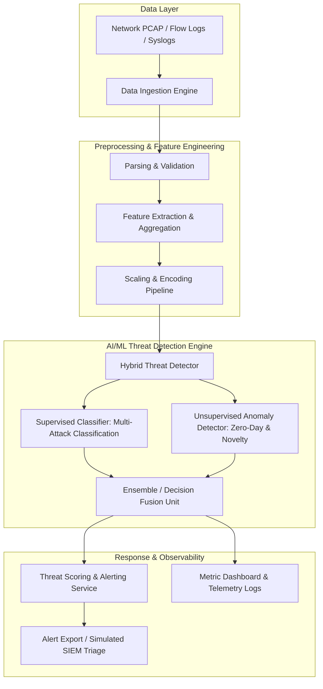

# System Architecture & Technical Design

## 1. High-Level Architectural Overview

The **AI-Powered Cybersecurity Threat Detection** system is designed as a modular, high-throughput pipeline capable of detecting known malicious patterns (signature/rule-informed supervised learning) as well as zero-day attacks and anomalous activities (unsupervised/semi-supervised anomaly detection).

---

## 2. System Layers & Component Breakdown

### 2.1 Ingestion Layer
- **Responsibility:** Ingest continuous network telemetry, PCAP captures, network flow records (NetFlow/IPFIX/Zeek/CICFlowMeter), and server event logs.
- **Key Characteristics:** Asynchronous I/O, streaming or batch buffer support, schema validation.

### 2.2 Preprocessing & Feature Transformation Layer
- **Responsibility:** Cleanse raw telemetry, handle missing values, drop invariant/noise features, encode categorical variables (e.g., protocols, services, flags), and scale continuous numerical flow metrics.
- **Artifacts:** Deterministic, serialized transformation pipelines ensuring identical distributions at training and inference.

### 2.3 Detection & AI Core Layer
- **Supervised Detection:** Identifies predefined threat classes (e.g., DoS/DDoS, Port Scan, Brute Force, Web Attacks, Botnets, Infiltration).
- **Unsupervised Anomaly Detection:** Flags statistical deviations and anomalous network flows using reconstruction loss or isolation mechanisms to catch novel/zero-day attacks.
- **Ensemble Fusion:** Combines anomaly scores with classification probabilities for calibrated confidence scores and reduced false-positive rates.

### 2.4 Alerting & Reporting Layer
- **Responsibility:** Emit standardized threat incident events (JSON/CEF/Syslog) enriched with threat severity, confidence rating, contributing features (explainability via SHAP/Feature Importances), and remediation context.

---

## 3. Technology Stack

- **Runtime & Language:** Python 3.10+
- **Data Manipulation:** `pandas`, `numpy`, `polars` / `pyarrow`
- **Machine Learning & Modeling:** `scikit-learn`, `xgboost`, `lightgbm`, `torch` (PyTorch)
- **Feature Explainability:** `shap`
- **Verification & Testing:** `pytest`, deterministic mock generators
