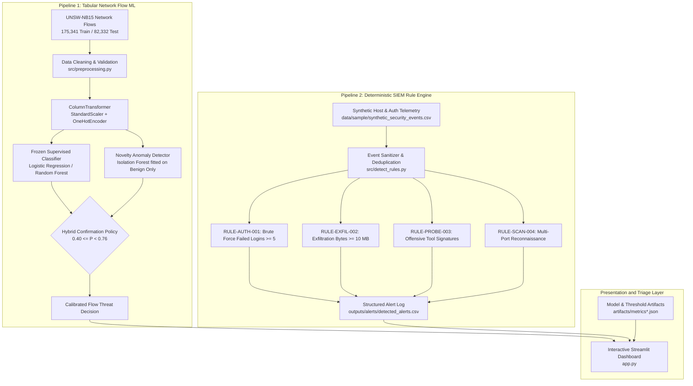

# System Architecture and Technical Design

## 1. High-Level Architectural Overview

The AI-Powered Cybersecurity Threat Detection system is an applied machine learning and security engineering prototype. It implements two decoupled detection pipelines:

1. Supervised and Novelty Machine Learning Pipeline: Evaluates tabular network flow traffic from the authentic UNSW-NB15 benchmark, featuring leak-free threshold calibration, parameter-invariant models, and hybrid anomaly gating.
2. Deterministic Rule-Based SIEM Engine: Ingests structured host and authentication telemetry to detect brute-force attacks, data exfiltration, reconnaissance scans, and offensive tool user-agents.

---

## 2. Core Architectural Pillars

### Pillar 1: Tabular Network Flow Machine Learning Pipeline
- Ingestion and Validation: Ingests official UNSW-NB15 training (175,341 flows) and testing (82,332 flows) CSV datasets. Excludes sequence identifiers (`id`) and multi-class categories (`attack_cat`) from feature matrices to prevent identity memorization.
- Preprocessing: Standardizes numerical flow metrics using `StandardScaler` (median-imputed) and categorical protocols, services, and connection states using `OneHotEncoder(handle_unknown='ignore')`.
- Linear Supervised Baseline: Logistic Regression calibrated under strict leakage-prevention protocols.
- Non-Linear Supervised Ensemble: Random Forest Classifier (100 estimators, max depth 15) capturing non-linear feature interactions.
- Unsupervised Novelty Anomaly Detection: An Isolation Forest fitted exclusively on benign traffic (label = 0, N=44,800 records) to establish a baseline of normal network behavior.
- Hybrid Gating Policy: An ambiguous-band confirmation mechanism (0.40 <= P < 0.76) that captures missed attacks while constraining false alarm inflation.

### Pillar 2: Deterministic Rule-Based SIEM Engine
- Ingestion: Parses simulated host event logs containing timestamps, source IPs, destination IPs, ports, authentication failure counters, payload byte volumes, packet counts, and User-Agent strings.
- Rule Evaluation: Runs deterministic heuristic rules identifying credential stuffing, large-scale data transfers, automated vulnerability scanners, and port sweeps.
- Alert Persistence: Exports standardized alerts to CSV (`outputs/alerts/detected_alerts.csv`) containing unique alert IDs, triggering event IDs, severity classifications (Critical, High, Medium, Low), and human-readable evidence strings.

### Pillar 3: Presentation and Operational Triage Layer
- Interactive Streamlit Application (`app.py`): Provides SOC analysts and engineering reviewers with five dedicated interfaces:
  1. System Overview: Pipeline architecture, operational boundaries, and module summaries.
  2. Model Evaluation and Comparison: Head-to-head metrics, confusion matrices, ROC curves, PR curves, and parameter-invariant threshold diagnostics.
  3. Anomaly Detection and Hybrid Defense: Isolation Forest score distributions, false positive trade-off curves, and candidate sweep results.
  4. Rule-Based SIEM Alerts: Tabular alert triage table with severity filtering and raw evidence inspection.
  5. Dataset Explorer: Interactive telemetry viewer for synthetic host logs and benchmark flow schemas.

---

## 3. Technology Stack and Dependencies

- Language Runtime: Python 3.10+
- Machine Learning and Preprocessing: `scikit-learn` (Pipelines, ColumnTransformer, LogisticRegression, RandomForestClassifier, IsolationForest, Metrics)
- Data Manipulation and Analytics: `pandas`, `numpy`
- Visualization and Headless Plotting: `matplotlib` (using the non-interactive Agg backend)
- Model Persistence: `joblib`
- Web Presentation: `streamlit`
- Testing and Quality Assurance: `pytest` (63 automated unit and integration tests)

---

## 4. Architectural Boundaries and Limitations

1. Decoupled Schemas: Network flow classifications on the UNSW-NB15 benchmark are completely separate from host-level authentication and probe telemetry. The schemas are distinct and evaluated independently.
2. Batch Processing Prototype: This system operates on tabular benchmark records and batch event logs. It does not perform live kernel-level packet capture, inline packet filtering, or real-time packet assembly.
3. Offline Advisory Role: The system generates triage alerts and evaluation metrics. It does not execute automated firewall reconfigurations, network interface resets, or process terminations.
4. Fictional Demonstration Data: Host security event records in `data/sample/synthetic_security_events.csv` are synthetically generated for reproducible unit testing and rule verification.
