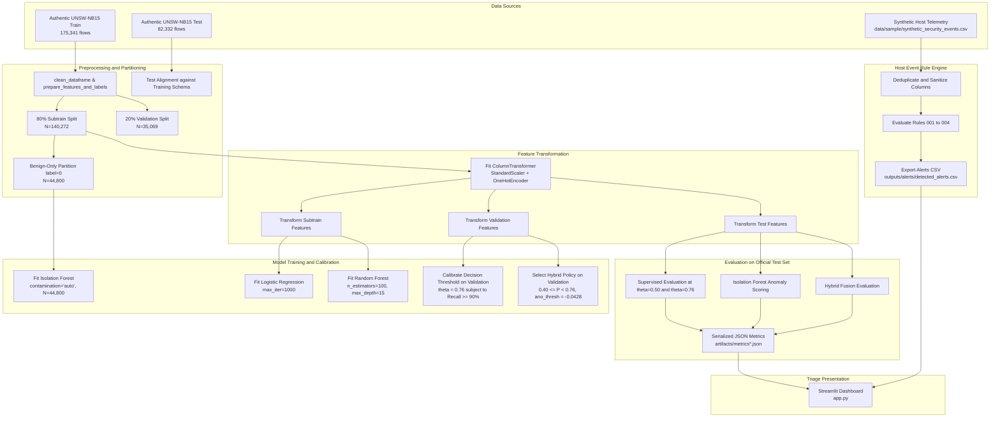

# End-to-End Data Flow and Pipeline Lifecycle

## 1. High-Level Data Lifecycle

The system processes two distinct telemetry pipelines in an offline, batch architecture:

1. Tabular Network Flows (UNSW-NB15 Benchmark): Flows traverse cleaning, encoding, scaling, model inference, and hybrid decision logic.
2. Synthetic Host Events (SIEM Telemetry): Event logs traverse deduplication, schema sanitization, deterministic rule evaluation, and alert serialization.



---

## 2. Granular Stage Specifications

### Stage 1: Ingestion and Preprocessing (`src/preprocessing.py`)

1. Column Sanitization:
   - Strips leading and trailing whitespace from column headers and converts names to lowercase.
   - For categorical columns (`proto`, `service`, `state`), converts `-` and empty strings to the standard placeholder `unknown`.
2. Target Extraction and Integrity Validation:
   - Identifies the target column (`label`).
   - Coerces target values to numeric integers and strictly asserts binary status (`0` for Benign, `1` for Attack).
   - Drops non-feature identifiers (`id`) and multi-class target labels (`attack_cat`) to prevent identifier memorization and label leakage.
3. Numerical Imputation:
   - Identifies infinite values (`inf`, `-inf`) and replaces them with `NaN`.
   - Imputes missing numerical values with the median of each feature column.
4. Categorical Transformation:
   - Configures `OneHotEncoder(handle_unknown='ignore', sparse_output=False)` to prevent failures when encountering unseen categories during test inference.

---

### Stage 2: Leak-Free Training and Validation Partitioning (`src/benchmark_audit.py`)

To eliminate optimism bias and data leakage, threshold calibration follows a strict protocol:

1. Official Training Set Partitioning:
   - The official training set (175,341 records) is partitioned into an 80% subtraining split (140,272 records) and a 20% validation split (35,069 records) using stratified sampling.
2. Official Test Set Isolation:
   - The official test dataset (82,332 records) is completely unobserved during model fitting, threshold exploration, and policy selection.
3. Parameter Invariance Guarantee:
   - The model pipeline is fitted exclusively on the 80% subtraining split.
   - The decision threshold ($\theta = 0.76$) is selected on the 20% validation split.
   - The exact same fitted pipeline is evaluated directly on the official test set without refitting, eliminating calibration drift.

---

### Stage 3: Anomaly Detection and Hybrid Fusion (`src/anomaly_detection.py`)

1. Benign-Only Model Fitting:
   - Normal traffic flows (`label = 0`, N=44,800 records) are extracted from the subtraining split.
   - An `IsolationForest(n_estimators=100, max_samples=256, contamination='auto')` is fitted exclusively on this benign baseline.
2. Anomaly Scoring Convention:
   - Scikit-learn's `decision_function(X)` returns positive values for normal inliers and negative values for abnormal outliers.
   - The system defines the continuous anomaly score as:
     ```text
     anomaly_score = -decision_function(X)
     ```
   - Higher scores indicate greater deviation from benign baseline traffic.
3. Decision Threshold Selection:
   - The anomaly decision threshold (`threshold = -0.0428`) is selected on the validation split by maximizing recall subject to validation FPR <= 7.5%.
4. Hybrid Fusion Gating:
   - Supervised Baseline: Alerts if `P_attack >= 0.76`.
   - Cascaded OR: Alerts if `P_attack >= 0.76 or anomaly_score >= -0.0428`.
   - Suspicious-Band Confirmation: Alerts if:
     ```text
     P_attack >= 0.76 or (0.40 <= P_attack < 0.76 and anomaly_score >= -0.0428)
     ```

---

### Stage 4: Deterministic SIEM Rule Evaluation (`src/detect_rules.py`)

1. Event Ingestion:
   - Ingests `data/sample/synthetic_security_events.csv`.
   - Deduplicates records on `event_id`.
   - Enforces type safety: numeric conversion for `failed_logins`, `byte_count`, `packet_count`, and `destination_port`.
2. Rule Execution:
   - Evaluates each record sequentially against deterministic criteria (credential stuffing, data exfiltration, offensive tool User-Agents, and port scans).
3. Alert Serialization:
   - Outputs structured records to `outputs/alerts/detected_alerts.csv` with unique alert IDs, timestamps, IP pairs, severity ratings, and explicit trigger evidence.
