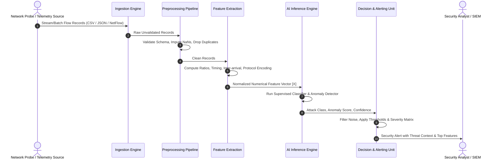

# End-to-End Data Flow & Pipeline Architecture

## 1. Data Lifecycle Overview

The data flow within the system follows a deterministic, unidirectional pipeline designed for low latency and high fidelity.

---

## 2. Granular Stage Specifications

### Stage 1: Ingestion & Validation
- **Input:** Raw network flow records (containing IP header metrics, TCP flags, duration, packet counts, byte counts).
- **Checks:**
  - Verify field presence and types.
  - Drop malformed records.
  - Remove infinite / corrupt values (e.g., flow packets/s becoming infinite on zero flow duration).

### Stage 2: Feature Transformation
Raw telemetry cannot be fed directly into machine learning models without calibration. Transformations include:
1. **Flow Timing Aggregates:**
   - Flow Duration
   - Flow Inter-Arrival Times (IAT Mean, Std, Max, Min)
2. **Packet & Byte Statistics:**
   - Total Forward/Backward Packets
   - Total Forward/Backward Bytes
   - Packet Length Statistics (Mean, Variance, Skewness)
3. **TCP Flag Distributions:**
   - SYN, ACK, FIN, RST, PSH, URG flag counts and ratios.
4. **Rate Calculations:**
   - Flow Bytes/s, Flow Packets/s (clipped to prevent numerical explosion).
5. **Normalization & Scaling:**
   - Robust scaling / MinMax scaling fitted exclusively on baseline training data to avoid data leakage.

### Stage 3: Inference & Ensemble Scoring
1. **Anomaly Score Calculation ($S_{anomaly}$):**
   - Unsupervised model evaluates flow normality. A high reconstruction error or isolation depth indicates an anomaly.
2. **Multi-Class Attack Probability ($P_{class}$):**
   - Supervised model estimates probability vector across all target attack types:
     $$\mathbf{P} = [p_{\text{BENIGN}}, p_{\text{DoS}}, p_{\text{DDoS}}, p_{\text{PortScan}}, p_{\text{BruteForce}}, \dots]$$
3. **Fusion Logic:**
   - If $S_{anomaly} > \tau_{anomaly}$ and $\arg\max(\mathbf{P}) = \text{BENIGN}$, the flow is flagged as a **Potential Zero-Day / Novel Anomaly**.
   - If $\arg\max(\mathbf{P}) \neq \text{BENIGN}$, the specific threat signature is identified with confidence $\max(\mathbf{P})$.

### Stage 4: Alert Dispatch & Explainability
- Evaluates threat severity (Critical, High, Medium, Low).
- Extracts top contributing features using local feature attribution.
- Outputs structured JSON payload for SIEM ingestion.
