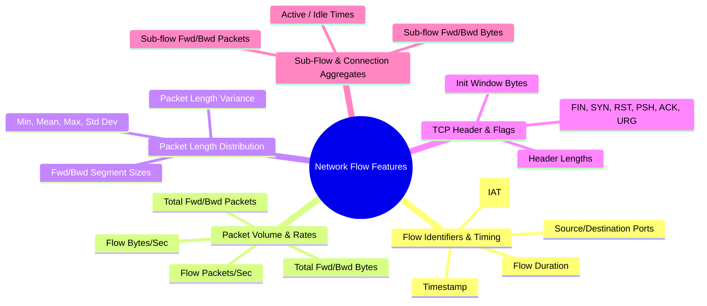

# Cybersecurity Dataset Specifications & Feature Reference

## 1. Primary Benchmark Datasets

The threat detection pipeline is designed to interface with industry-standard network security benchmark datasets:

| Dataset | Provider / Origin | Primary Attack Vectors | Key Characteristics |
| :--- | :--- | :--- | :--- |
| **CIC-IDS2017** | Canadian Institute for Cybersecurity (UNB) | DoS, DDoS, PortScan, Brute Force (FTP/SSH), Web Attack, Botnet, Infiltration | Realistic background traffic, 80+ network flow features extracted via CICFlowMeter, 2.8M records across 5 days. |
| **UNSW-NB15** | Cyber Range Lab of UNSW Canberra | Fuzzers, Analysis, Backdoors, DoS, Exploits, Generic, Reconnaissance, Shellcode, Worms | Synthesized network traffic with modern low footprint attack scenarios and flow features. |
| **NSL-KDD** | University of New Brunswick | DoS, Probe, R2L (Remote to Local), U2R (User to Root) | Classic benchmark for testing algorithm efficacy on clean, standardized protocol traffic. |

---

## 2. Core Feature Taxonomy

Network flow features fall into 5 distinct analytical categories:



---

## 3. Label Taxonomy & Attack Categories

Target variable representations:
1. **Binary Classification:**
   - `0`: Benign (Normal Traffic)
   - `1`: Malicious (Any Attack)
2. **Multi-Class Threat Classification:**
   - `Benign`
   - `DoS / DDoS` (e.g., GoldenEye, Slowloris, Hulk, LOIC)
   - `PortScan / Reconnaissance`
   - `Brute Force` (SSH-Patator, FTP-Patator)
   - `Web Attacks` (SQL Injection, XSS, Brute Force)
   - `Botnet` (ARES, Mirai patterns)
   - `Infiltration / Priv-Escalation`

---

## 4. Addressing Data Imbalance & Leakage Prevention

### Class Imbalance Mitigation
- **Cost-Sensitive Learning:** Compute balanced class weights inversely proportional to class frequencies:
  $$w_c = \frac{N}{K \cdot N_c}$$
  where $N$ is total samples, $K$ is number of classes, and $N_c$ is count of samples in class $c$.
- **Focal Loss / Sampling:** Downsampling massive benign flows or employing SMOTE/Borderline-SMOTE on scarce attack classes in the training set only.

### Preventing Data Leakage
- **Split Protocol:** Train/Validation/Test splits must be stratified and strictly partitioned before any imputation or scaling.
- **Identifier Masking:** IP addresses and ephemeral client ports are excluded from feature sets to prevent models from memorizing IP-specific signatures rather than generalizing traffic behavior.

---

## 5. Authentic Benchmark vs. Demonstration Sample Data

| Aspect | Authentic UNSW-NB15 Benchmark | Demonstration Sample (`data/sample/unsw_sample.csv`) |
| :--- | :--- | :--- |
| **Origin** | Cyber Range Lab of UNSW Canberra ([Official Source](https://research.unsw.edu.au/projects/unsw-nb15-dataset)) | Deterministic synthetic schema mock generated for test suites and offline review. |
| **File Location** | `data/raw/UNSW_NB15_training-set.csv` & `data/raw/UNSW_NB15_testing-set.csv` | [`data/sample/unsw_sample.csv`](file:///d:/Projects/Artificial%20Intelligence/AI-Powered%20Cybersecurity%20Threat%20Detection/data/sample/unsw_sample.csv) |
| **Evaluation Scope** | Authentic evaluation of real-world intrusion detection capability. | Verifies code reproducibility and pipeline execution without downloading large files. |
| **Training Command** | `python src/train.py` | `python src/train.py --sample` |
| **Status in Repository** | Local copy in `data/raw/` verified (excluded from Git version control). Preflight validation strictly enforces file availability. | Bundled in repository for instant test suite verification. |


---

## 6. Official Academic Citation

When utilizing or publishing results from this benchmark, cite the original publication:

```bibtex
@inproceedings{moustafa2015unsw,
  title={UNSW-NB15: a comprehensive data set for network intrusion detection systems (UNSW-NB15 network data set)},
  author={Moustafa, Nour and Slay, Jill},
  booktitle={2015 Military Communications and Information Systems Conference (MilCIS)},
  pages={1--6},
  year={2015},
  organization={IEEE},
  doi={10.1109/MilCIS.2015.7348942}
}
```

> **Citation (IEEE):**
> N. Moustafa and J. Slay, "UNSW-NB15: a comprehensive data set for network intrusion detection systems (UNSW-NB15 network data set)," in *2015 Military Communications and Information Systems Conference (MilCIS)*, Canberra, ACT, Australia, 2015, pp. 1-6, doi: 10.1109/MilCIS.2015.7348942.

---

## 7. UNSW-NB15 Comprehensive Feature Dictionary

The UNSW-NB15 feature set consists of 49 features grouped into 6 logical categories, plus target variables:

### 1. Flow Identifiers (Excluded from model features to prevent memorization)
- `id`: Sequence identifier integer (dropped from features).
- `srcip`: Source IP address (dropped from features if present in raw captures).
- `sport`: Source port number (dropped from features if present).
- `dstip`: Destination IP address (dropped from features if present).
- `dsport`: Destination port number (dropped from features if present).

### 2. Basic Flow Features
- `dur` (*float*): Record total duration (seconds).
- `proto` (*nominal*): Transaction protocol (e.g., `tcp`, `udp`, `arp`, `icmp`).
- `service` (*nominal*): Application service (e.g., `http`, `ftp`, `smtp`, `ssh`, `dns`, `-` mapped to `unknown`).
- `state` (*nominal*): Connection state indicator (e.g., `FIN`, `INT`, `CON`, `REQ`, `RST`).
- `spkts` (*integer*): Source to destination packet count.
- `dpkts` (*integer*): Destination to source packet count.
- `sbytes` (*integer*): Source to destination transaction bytes.
- `dbytes` (*integer*): Destination to source transaction bytes.
- `rate` (*float*): Overall packet transmission rate (packets/sec).

### 3. Content Features
- `sttl` (*integer*): Source to destination time-to-live value.
- `dttl` (*integer*): Destination to source time-to-live value.
- `sload` (*float*): Source bits per second.
- `dload` (*float*): Destination bits per second.
- `sloss` (*integer*): Source packets retransmitted or dropped.
- `dloss` (*integer*): Destination packets retransmitted or dropped.
- `sinpkt` (*float*): Source inter-packet arrival time (milliseconds).
- `dinpkt` (*float*): Destination inter-packet arrival time (milliseconds).
- `sjit` (*float*): Source jitter (milliseconds).
- `djit` (*float*): Destination jitter (milliseconds).
- `swin` (*integer*): Source TCP window advertisement value.
- `stcpb` (*integer*): Source TCP base sequence number.
- `dtcpb` (*integer*): Destination TCP base sequence number.
- `dwin` (*integer*): Destination TCP window advertisement value.
- `tcprtt` (*float*): TCP round-trip time (`synack` + `ackdat`).
- `synack` (*float*): TCP SYN to SYN-ACK setup time.
- `ackdat` (*float*): TCP SYN-ACK to ACK completion time.
- `smean` (*integer*): Mean packet size transmitted by source.
- `dmean` (*integer*): Mean packet size transmitted by destination.
- `trans_depth` (*integer*): Pipelined HTTP request/response transaction depth.
- `response_body_len` (*integer*): Actual uncompressed content length of HTTP response.

### 4. Connection & Count Features (100-connection sliding window)
- `ct_srv_src`: Connections with same service and source address in past 100 flows.
- `ct_state_ttl`: Connections with identical state and TTL combination.
- `ct_dst_ltm`: Connections to same destination address in past 100 flows.
- `ct_src_dport_ltm`: Connections from same source to same destination port.
- `ct_dst_sport_ltm`: Connections from same destination to same source port.
- `ct_dst_src_ltm`: Connections between same source and destination address pair.
- `is_ftp_login` (*binary*): 1 if FTP session logged in with valid credentials, 0 otherwise.
- `ct_ftp_cmd`: Count of FTP commands issued in the session.
- `ct_flw_http_mthd`: Count of HTTP methods (`GET`, `POST`, etc.) in flow.
- `ct_src_ltm`: Connections from same source address in past 100 flows.
- `ct_srv_dst`: Connections with same service to same destination address.
- `is_sm_ips_ports` (*binary*): 1 if source and destination IP and ports are equal (LAND attack indicator).

### 5. Target Labels
- `label` (*binary integer*): `0` for Benign/Normal traffic; `1` for Attack/Malicious traffic.
- `attack_cat` (*nominal*): Threat category (`Normal`, `Fuzzers`, `Analysis`, `Backdoors`, `DoS`, `Exploits`, `Generic`, `Reconnaissance`, `Shellcode`, `Worms`).

---

## 8. Manual Setup & Verification Workflow

```powershell
# 1. Download official CSVs to data/raw/
#    - UNSW_NB15_training-set.csv (175,341 rows)
#    - UNSW_NB15_testing-set.csv (82,332 rows)

# 2. Inspect dataset dimensions, feature distributions, and class balance
python src/inspect_data.py data/raw/UNSW_NB15_training-set.csv
python src/inspect_data.py data/raw/UNSW_NB15_testing-set.csv

# 3. Train authentic Logistic Regression baseline pipeline
python src/train.py

# 4. Optional: Train Random Forest benchmark
python src/train.py --classifier random_forest

# 5. Launch interactive SOC dashboard to visualize metrics
streamlit run app.py
```
