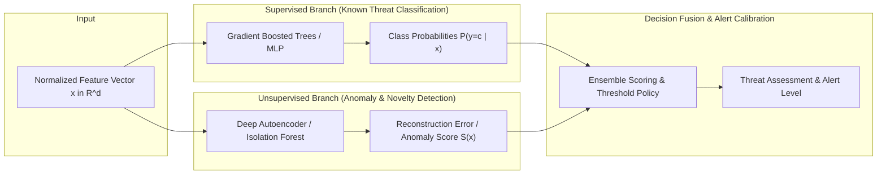

# Model Architecture & Learning Mechanics

## 1. Learning Paradigms

Cybersecurity threat detection encounters two primary challenges:
1. **Known Attacks:** Best detected via supervised classification leveraging known signatures and behavioral feature patterns.
2. **Zero-Day & Polymorphic Attacks:** Best detected via unsupervised anomaly detection trained on normal benign baselines.

To resolve both, this system employs a **Hybrid Learning Architecture**.

---

## 2. Supervised Learning Engine

### Objective Function
For multi-class threat classification with $K$ classes, the network optimizes the weighted Cross-Entropy Loss:
$$\mathcal{L}_{CE} = - \sum_{i=1}^{N} \sum_{k=1}^{K} w_k \cdot y_{i,k} \log(\hat{p}_{i,k})$$
where $y_{i,k} \in \{0, 1\}$ is the ground-truth one-hot label, $\hat{p}_{i,k}$ is the predicted probability from the softmax activation, and $w_k$ is the class penalty weight.

### Algorithmic Approaches
1. **Linear Baseline — Regularized Logistic Regression:**
   - Serves as the project's canonical linear benchmark model for binary intrusion classification (`0: Normal`, `1: Attack`).
   - Highly interpretable log-odds coefficients and rapid convergence under standardized numerical inputs.
   - Evaluated using the standard `StandardScaler` + `OneHotEncoder` preprocessing pipeline.
2. **Ensemble Models (Random Forest / GBDT):**
   - Non-linear tabular modeling on network flow statistics.
   - Robust against feature correlations and non-normal traffic distributions.
   - Computes feature importance metrics for operational explainability.
3. **Deep Neural Network (PyTorch MLP / 1D-CNN):**
   - Fully connected layers with Batch Normalization, Dropout (regularization), and LeakyReLU activations.
   - Trained via `AdamW` optimizer with weight decay and Cosine Annealing learning rate schedules.

---

## 3. Unsupervised Anomaly Detection Engine

### Autoencoder Learning Mechanics
The autoencoder learns the manifold of standard, benign network operations.

1. **Architecture:**
   - **Encoder:** Compresses input feature vector $\mathbf{x} \in \mathbb{R}^d$ into a lower-dimensional latent bottleneck $\mathbf{z} \in \mathbb{R}^m$ ($m \ll d$):
     $$\mathbf{z} = \sigma(\mathbf{W}_e \mathbf{x} + \mathbf{b}_e)$$
   - **Decoder:** Reconstructs the original vector from $\mathbf{z}$:
     $$\mathbf{\hat{x}} = \sigma(\mathbf{W}_d \mathbf{z} + \mathbf{b}_d)$$
2. **Loss Function (Reconstruction Loss):**
   $$\mathcal{L}_{recon} = \frac{1}{d} \sum_{j=1}^{d} (x_j - \hat{x}_j)^2$$
3. **Inference Principle:**
   - Because the autoencoder is trained strictly on **benign network flows**, it successfully reconstructs typical network behavior with near-zero error.
   - When anomalous or zero-day attack traffic appears, the latent representation fails to generalize, yielding a sharp spike in reconstruction error:
     $$\text{Anomaly Score } S(\mathbf{x}) = \|\mathbf{x} - \mathbf{\hat{x}}\|_2^2$$
   - An anomaly threshold $\tau$ is calibrated using the $(1-\alpha)$ quantile (e.g. 99th percentile) of benign validation reconstruction errors.

---

## 4. Evaluation & Performance Metrics

In cybersecurity, **False Positive Rate (FPR)** is as vital as Detection Rate (Recall) because excessive false alarms cause analyst alert fatigue.

- **Precision:** $\frac{TP}{TP + FP}$ (Reliability of alarms)
- **Recall (Detection Rate):** $\frac{TP}{TP + FN}$ (Coverage of attacks)
- **F1-Score / Macro F1:** Harmonic mean of Precision and Recall across imbalanced classes.
- **False Alarm Rate (FAR / FPR):** $\frac{FP}{TN + FP}$ (Target: $< 0.1\%$).
- **ROC-AUC & PR-AUC:** Area under Receiver Operating Characteristic and Precision-Recall Curves.
