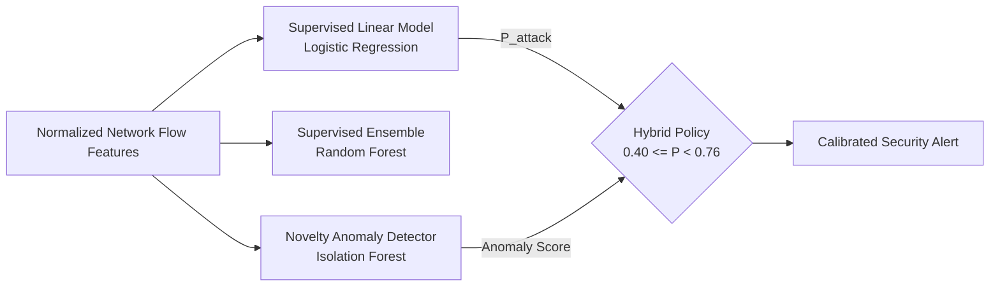
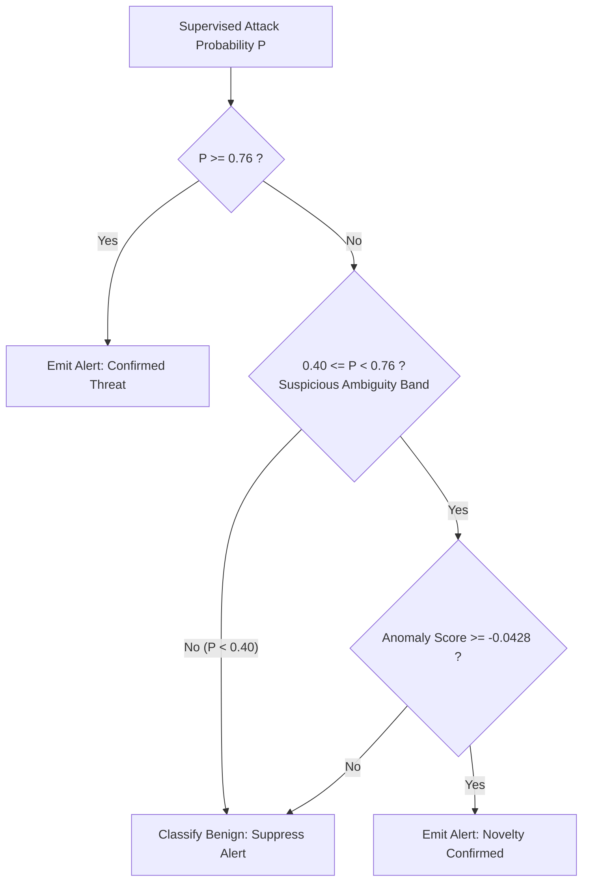

# Model Architecture and Learning Mechanics

## 1. Learning Paradigms and Threat Detection Strategy

Network intrusion detection presents two competing operational challenges:
1. High Detection Rate (Recall): Security Operations Centers (SOCs) must identify stealthy intrusions before lateral movement occurs.
2. Low False Positive Rate (FPR): Excessive false alarms create analyst alert fatigue, leading to missed security incidents.

To address both challenges, this system implements a multi-tiered architecture evaluated on the authentic UNSW-NB15 benchmark:
- Linear Supervised Classification (Calibrated Logistic Regression).
- Non-Linear Supervised Ensemble (Random Forest).
- Unsupervised Novelty Anomaly Detection (Isolation Forest fitted strictly on benign traffic).
- Hybrid Decision Gating (Suspicious-Band Confirmation).

---

## 2. Supervised Learning Mechanics

### 2.1 Logistic Regression Baseline

Logistic Regression models the log-odds of a flow being malicious as a linear combination of standardized input features:

$$\log \left( \frac{P(y=1 \mid \mathbf{x})}{1 - P(y=1 \mid \mathbf{x})} \right) = \mathbf{w}^T \mathbf{x} + b$$

The posterior attack probability is obtained via the sigmoid activation:

$$P(y=1 \mid \mathbf{x}) = \sigma(\mathbf{w}^T \mathbf{x} + b) = \frac{1}{1 + e^{-(\mathbf{w}^T \mathbf{x} + b)}}$$

#### Standard Default Decision Rule ($\theta = 0.50$):
$$\hat{y} = \begin{cases} 1, & \text{if } P(y=1 \mid \mathbf{x}) \ge 0.50 \\ 0, & \text{otherwise} \end{cases}$$

- Strengths: Highly interpretable, rapid convergence, convex optimization (no local minima).
- Operational Limitation at Default Threshold: While achieving 97.31% recall on the UNSW-NB15 test set, the default threshold produces a 39.01% false positive rate (14,434 false alarms out of 37,000 normal flows), overwhelming SOC triage capacity.

---

### 2.2 Random Forest Classifier Ensemble

The Random Forest constructs an ensemble of $B = 100$ decorrelated decision trees using bootstrap aggregating (bagging) and random feature subspace sampling:

$$\hat{y} = \text{mode} \left( \{ T_b(\mathbf{x}) \}_{b=1}^{B} \right), \quad P(y=1 \mid \mathbf{x}) = \frac{1}{B} \sum_{b=1}^{B} \mathbb{I}(T_b(\mathbf{x}) = 1)$$

- Hyperparameters: `n_estimators=100`, `max_depth=15`, `min_samples_split=5`, `random_state=42`.
- Strengths: Captures complex non-linear boundary interactions between flow duration, packet rates, and TCP flags without requiring explicit feature interaction terms.
- Performance: Achieves 99.14% attack recall, 0.9822 ROC-AUC, and 0.9868 PR-AUC on the held-out test set.

---

## 3. Unsupervised Novelty Anomaly Detection

### 3.1 Isolation Forest Mechanics

The Isolation Forest isolates observations by randomly selecting a feature and randomly selecting a split value between the feature's minimum and maximum values.

- Principle: Normal, benign network flows require many random partitions to isolate. Anomalies and novel attacks exhibit atypical feature values and isolate close to the tree roots with short path lengths.
- Average Path Length Normalization:
  For a dataset of $n$ instances, the average path length of an unsuccessful search in a Binary Search Tree (BST) is:
  $$c(n) = 2 \left( \ln(n - 1) + 0.5772156649 \right) - \frac{2(n - 1)}{n}$$
- Anomaly Score Formulation:
  The anomaly score $s(\mathbf{x}, n)$ is bounded between 0 and 1:
  $$s(\mathbf{x}, n) = 2^{-\frac{\mathbb{E}(h(\mathbf{x}))}{c(n)}}$$
  where $h(\mathbf{x})$ is the path length of observation $\mathbf{x}$ across the ensemble of isolation trees.

### 3.2 Benign-Only Fitting Protocol

In typical unsupervised deployments, anomaly detectors trained on unfiltered traffic learn attack clusters as part of the normal data distribution.
- System Protocol: The Isolation Forest (`n_estimators=100`, `max_samples=256`, `contamination="auto"`) is fitted exclusively on benign traffic (`label = 0`, N=44,800 records) extracted from the subtraining split.
- Scoring Convention: Scikit-learn defines `decision_function(X)` such that positive values indicate inliers and negative values indicate outliers. The system inverts this output:
  $$\text{anomaly\_score} = -\text{decision\_function}(\mathbf{x})$$
  Higher scores represent greater deviations from standard benign traffic patterns.

---

## 4. Leak-Free Threshold Calibration

### 4.1 Formal Calibration Objective

Threshold selection is formulated as a constrained optimization problem:

$$\theta^* = \arg\min_{\theta \in [0.05, 0.95]} \text{FPR}(\theta) \quad \text{subject to } \text{Recall}(\theta) \ge 90.0\%$$

### 4.2 Parameter Invariance and Elimination of Refit Drift

In classical machine learning workflows, engineers select a threshold via cross-validation, then refit the model on 100% of the training data before test evaluation.
- The Refit Flaw: Refitting on 100% of the data alters sample size, gradients, and coefficient magnitudes, causing the optimal threshold to drift.
- The Parameter-Invariant Solution:
  1. The official training set is split into 80% subtrain (140,272 records) and 20% validation (35,069 records).
  2. The model is fitted exclusively on the 80% subtrain split.
  3. The decision threshold $\theta = 0.76$ is selected on the 20% validation split.
  4. The exact same fitted pipeline is evaluated directly on the test set without refitting. This guarantees zero refit drift and full parameter invariance.

---

## 5. Hybrid Gating and Decision Fusion

When combining supervised models with anomaly detectors, naive combination policies often degrade operational performance.

### 5.1 Cascaded OR Policy (Naive Stacking)
$$\text{Alert} = (P_{attack} \ge 0.76) \lor (\text{anomaly\_score} \ge -0.0428)$$
- Attack Recovery: Identifies 809 out of 5,044 attacks missed by the supervised model (16.04% recovery rate), lifting recall to 90.66%.
- Operational Cost: Simple logical OR adds 5,707 new false alarms, inflating test FPR from 15.94% to 31.37% (nearly doubling false alarms).

### 5.2 Suspicious-Band Confirmation Policy
$$\text{Alert} = (P_{attack} \ge 0.76) \lor \left( 0.40 \le P_{attack} < 0.76 \land \text{anomaly\_score} \ge -0.0428 \right)$$
- Mechanism: Restricts anomaly inspection exclusively to uncertain predictions ($0.40 \le P < 0.76$).
- Result: Achieves 90.00% recall while adding only 1,134 new false alarms (Test FPR = 19.01%, F1 = 87.59%).

---

## 6. Official Test Split Benchmark Performance (82,332 Records)

| Model Configuration | Decision Threshold | Accuracy | Precision | Recall | F1-Score | False Alarm Rate (FPR) | ROC-AUC | PR-AUC |
| :--- | :---: | :---: | :---: | :---: | :---: | :---: | :---: | :---: |
| Logistic Regression (Default Baseline) | $\theta = 0.50$ | 80.99% | 75.35% | 97.31% | 84.93% | 39.01% | 0.9561 | 0.9664 |
| **Logistic Regression (Consistent Frozen)** | **$\theta = 0.76$** | **86.71%** | **87.23%** | **88.87%** | **88.04%** | **15.94%** | **0.9554** | **0.9660** |
| Random Forest Classifier | $\theta = 0.50$ | 85.27% | 79.29% | 99.14% | 88.11% | 31.72% | 0.9822 | 0.9868 |
| Isolation Forest (Standalone Novelty) | $\theta = -0.0428$ | 71.36% | 79.66% | 64.44% | 71.24% | 20.16% | 0.7899 | 0.8106 |
| Hybrid Policy 1: Cascaded OR | Dual Gating | 80.76% | 77.98% | 90.66% | 83.84% | 31.37% | N/A | N/A |
| **Hybrid Policy 2: Band Confirmation** | **$0.40 \le P < 0.76$** | **85.95%** | **85.30%** | **90.00%** | **87.59%** | **19.01%** | **N/A** | **N/A** |
