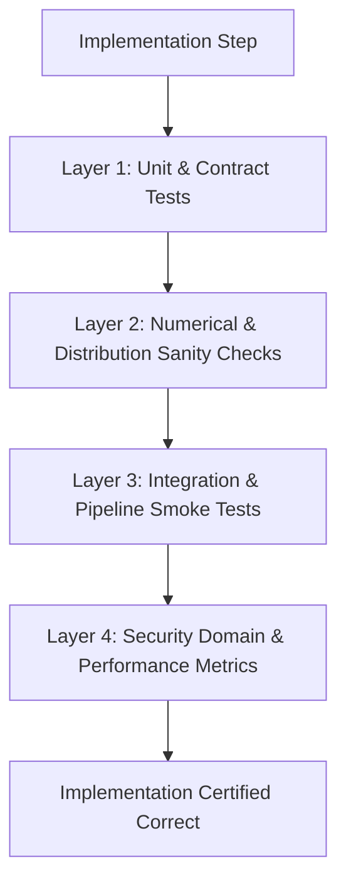

# Implementation Validation & Verification Protocol

## 1. Purpose & Standards

This document establishes the verification protocols used to validate every module and implementation step in the project. For each newly developed component, an automated test or sanity benchmark is executed to ensure functional correctness, numerical stability, and absence of data leakage.

---

## 2. Validation Layers



### Layer 1: Unit & Contract Tests
- **Target:** Individual classes, methods, and functions.
- **Criteria:**
  - Input/Output data types and shapes match defined contracts.
  - Edge cases handled cleanly (zero duration flows, empty records, missing fields).
  - Framework: `pytest`.

### Layer 2: Numerical & Distribution Sanity Checks
- **Target:** Preprocessor, scalers, encoders, and feature transformers.
- **Criteria:**
  - **Zero Leakage:** Scalers and encoders fit solely on training partitions.
  - **No NaNs or Infs:** Output matrices are fully sanitized without missing or infinite values.
  - **Transformation Invariance:** The feature engineering logic produces identical transformations for single-record streaming as for batch processing.

### Layer 3: Integration & Pipeline Smoke Tests
- **Target:** End-to-end data pipeline from ingestion to inference and alerting.
- **Criteria:**
  - A synthetic batch of benign and attack traffic passes through all modules without errors.
  - Threat alerts emit the expected schema, correct timestamp format, and valid severity levels.

### Layer 4: Model Learning & Security Metrics Verification
- **Target:** Model training routines and convergence.
- **Criteria:**
  - **Loss Convergence:** Training and validation loss steadily decrease over training iterations.
  - **Non-Trivial Predictions:** Class distribution of predictions is non-degenerate (i.e. model does not simply predict the majority class).
  - **False Positive Rate (FPR):** FPR on clean baseline traffic does not exceed pre-set thresholds ($< 0.5\%$).
  - **Anomaly Detection Calibration:** Reconstruction error on synthetic anomalies is measurably higher than on benign baselines ($p < 0.001$).

---

## 3. Standard Verification Command

Whenever code is added or modified, validation is executed via:
```powershell
pytest tests/ -v --tb=short
```
Or running designated module verification scripts (e.g. `python scripts/verify_pipeline.py`).
