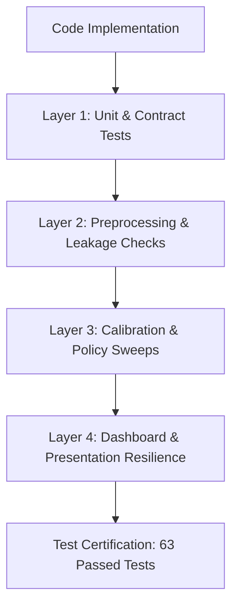

# Implementation Validation and Verification Protocol

## 1. Purpose and Verification Philosophy

This protocol defines the testing and verification standards enforced across the AI-Powered Cybersecurity Threat Detection system. Every module is verified against automated tests to ensure:
1. Functional Correctness: Functions adhere to strict type and output schema contracts.
2. Numerical Stability: No unhandled `NaN`, `inf`, or degenerate matrix inversions.
3. Methodological Integrity: Strict zero-leakage protocols preventing test-set exposure during preprocessing, threshold calibration, and policy sweeps.
4. Error Resilience: Graceful degradation when telemetry or artifacts are missing or corrupted.

---

## 2. Multi-Layer Testing Architecture



### Layer 1: Unit and Contract Tests
- `tests/test_rules.py`:
  - Validates that `RULE-AUTH-001`, `RULE-EXFIL-002`, `RULE-PROBE-003`, and `RULE-SCAN-004` trigger accurately at boundary conditions.
  - Verifies that deduplication prevents duplicate alert creation on identical `event_id` rows.
  - Verifies that emitted alerts contain all required fields with explicit trigger evidence.
- `tests/test_simulate.py`:
  - Asserts that simulated event DataFrames conform to required schema types and valid ISO 8601 timestamps.
  - Verifies that attack scenario generation reflects specified attack ratios.
- `tests/test_inspect.py`:
  - Validates CLI dataset inspection utility output structure.

### Layer 2: Preprocessing and Numerical Sanity
- `tests/test_pipeline.py`:
  - Validates `clean_dataframe`: column lowercasing, whitespace stripping, missing value handling.
  - Validates categorical standardization: replacement of `-` with `unknown`.
  - Verifies that `OneHotEncoder` handles previously unseen categories at inference time without raising exceptions.
  - Verifies that sequence identifiers (`id`) and multi-class labels (`attack_cat`) are strictly stripped from feature matrices.
  - Verifies that dataset preflight checks prevent accidental fallback from authentic benchmark files to sample data.

### Layer 3: Calibration and Policy Integrity
- `tests/test_benchmark_audit.py`:
  - Verifies that candidate threshold sweeps operate strictly on training partitions with zero test-set exposure.
  - Confirms Out-Of-Fold (OOF) cross-validation creates complete training probability distributions.
  - Asserts parameter invariance: the model evaluated on the test set retains the identical frozen parameters from the validation split.
- `tests/test_anomaly_detection.py`:
  - Asserts that the `IsolationForest` is fitted exclusively on benign flows (`label = 0`).
  - Confirms the anomaly score convention (`anomaly_score = -decision_function(X)`) where higher scores denote higher abnormality.
  - Validates that the Suspicious-Band confirmation policy (`0.40 <= P < 0.76`) correctly gates anomaly confirmation.

### Layer 4: Presentation and Dashboard State Resilience
- `tests/test_dashboard_states.py`:
  - Verifies that `load_json_artifact` and `load_model_pipeline` return graceful fallback indicators when artifacts are missing or corrupted (invalid JSON syntax or truncated joblib files).
  - Asserts that dashboard components do not crash when encountering partial artifacts.

---

## 3. Test Suite Execution

Run the complete automated test suite from the repository root:

```powershell
pytest -v
```

Execution benchmark:
```text
63 passed in ~8s
```
